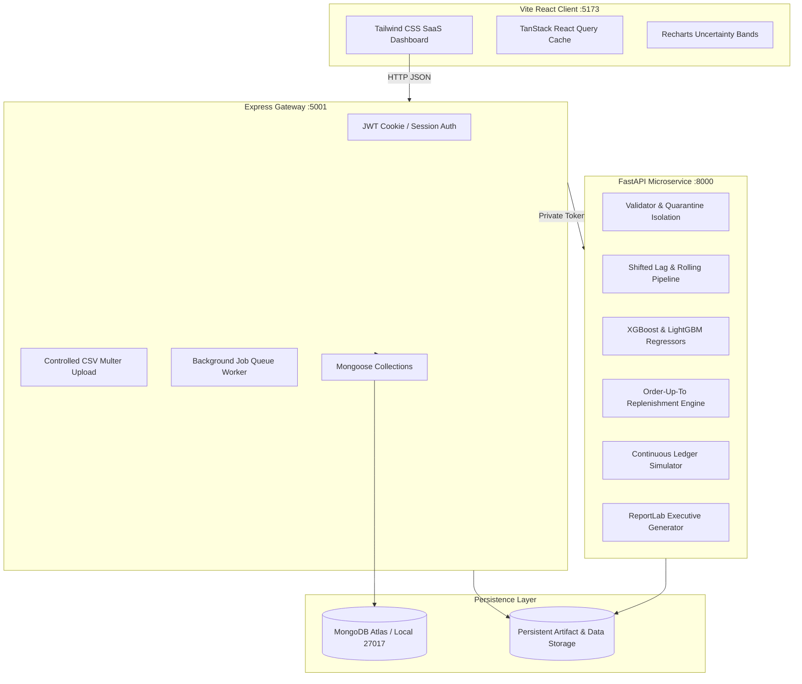

# QUICKSTOCK AI
### Demand Forecasting and Inventory Recommendation for Quick-Commerce Dark Stores
*Academic Inventory Decision-Support Prototype*

[](https://nodejs.org)
[](https://python.org)
[](https://mongodb.com)
[](https://docker.com)

---

## 1. Project Overview & Boundaries

**QuickStock AI** is an academic inventory decision-support prototype inspired by the stock-planning challenges faced by quick-commerce dark store operators.

The core pipeline executes end to end:
```
Historical Sales Data
  ↳ Validated Dataset & Quarantine Isolation
    ↳ Time-Aware Feature Engineering & Leakage Prevention
      ↳ Baseline & Machine Learning Model Training (LightGBM, XGBoost, Random Forest)
        ↳ Recursive Demand Forecasts & Calibrated Prediction Intervals
          ↳ Periodic-Review (R, S) Replenishment Recommendations
            ↳ Discrete-Event Inventory Backtesting & Policy Simulation
              ↳ Actionable Management Dashboard & Executive PDF Reports
```

> **Academic Prototype Boundaries**:
> 1. Any synthetic dataset, generated inventory assumptions, and simulated outcomes are synthetic or simulated.
> 2. QuickStock AI is not affiliated with, endorsed by, or operating on behalf of commercial quick-commerce companies (e.g. Blinkit or Zepto).
> 3. Forecasting frequency is strictly **DAILY** (no synthetic hourly records or shift-level claims are made).
> 4. Actual purchase order creation represents **local planning records only**; no external supplier purchase orders are transmitted.

---

## 2. Research Team (IIIT)

| Student Name | Roll Number | Academic Specialization |
| :--- | :--- | :--- |
| **Udaynoor Singh** | `IIT2024006` | Machine Learning & Time-Series Pipelines |
| **Disha Gupta** | `IIT2024039` | Data Validation & Provenance Architecture |
| **Ravindra Chaudhary** | `IIT2024056` | Inventory Replenishment & Decision Engine |
| **Tanishq Garg** | `IIT2024038` | Discrete-Event Simulator & Backtesting |
| **Ajay Kathar** | `IIT2024037` | Full-Stack Gateway & UI Architecture |
| **Abhijeet Jain** | `IIT2024044` | Quality Assurance & Empirical Evaluation |

---

## 3. Architecture Diagram



---

## 4. Quickstart: Exact Local Setup Instructions

### Prerequisites
- Node.js LTS (v20+ or v23+)
- Python 3.11+
- MongoDB 7.0 (local mongod running on `mongodb://127.0.0.1:27017` OR a MongoDB Atlas cluster URI)

### Step 1: Clone & Configure Environment
```bash
git clone <repository_url> quickstock-ai
cd quickstock-ai

# Copy environment template
cp .env.example .env
```

Review `.env`:
```env
API_PORT=5001
CLIENT_ORIGIN=http://localhost:5173
SESSION_SECRET=quickstock-super-secure-jwt-secret-academic-prototype-key-2026
MONGODB_URI=mongodb://127.0.0.1:27017/quickstock_ai
MONGODB_DB_NAME=quickstock_ai
ML_SERVICE_URL=http://127.0.0.1:8000
ML_SERVICE_TOKEN=qs-internal-auth-token-quickstock-secure-key-2026
```

### Step 2: Set Up Python ML Service
```bash
cd services/ml
python3 -m venv venv
./venv/bin/pip install --upgrade pip setuptools wheel
./venv/bin/pip install -r requirements.txt

# Run ML unit and integration test suite
./venv/bin/pytest -v
cd ../..
```

### Step 3: Set Up Node.js Gateway & Shared Packages
```bash
# Build shared contracts
cd packages/shared
npm install
npm run build
cd ../..

# Install and verify API gateway
cd apps/api
npm install
npm run test    # Runs API integration tests against MongoDB
npm run seed    # Seeds demo analyst credentials & initial dataset
cd ../..

# Install and build Web Frontend
cd apps/web
npm install
npm run build   # Verifies TypeScript & Vite production build
cd ../..
```

### Step 4: Run Application Services Concurrently
In three separate terminal windows (or via Docker Compose):

**Terminal 1 — Python ML Service (Port 8000):**
```bash
cd quickstock-ai/services/ml
./venv/bin/uvicorn app.main:app --host 127.0.0.1 --port 8000 --reload
```

**Terminal 2 — Node Express API Gateway (Port 5001):**
```bash
cd quickstock-ai/apps/api
npm run dev
```

**Terminal 3 — React Vite Web Application (Port 5173):**
```bash
cd quickstock-ai/apps/web
npm run dev
```

Open your browser to: **`http://localhost:5173`**

*(Default Analyst Account: `analyst@quickstock.local` / `quickstock123`)*

---

## 5. Docker Compose Local Execution

To run all four services (MongoDB, ML Microservice, Express API, and Nginx React Frontend) in containerized isolation:

```bash
docker compose up --build
```
Access the application at **`http://localhost:5173`**.

---

## 6. MongoDB Atlas Configuration Guide

To deploy persistent storage to MongoDB Atlas instead of a local database:

1. **Create an Atlas Cluster**:
   - Log in to [MongoDB Atlas](https://cloud.mongodb.com).
   - Create a free **M0 Sandbox** or dedicated cluster.
2. **Create Database User**:
   - Go to **Security → Database Access → Add New Database User**.
   - Select **Password Authentication**.
   - Grant role: `readWriteAnyDatabase` or scoped read/write to `quickstock_ai`.
3. **Configure Network Access**:
   - Go to **Security → Network Access → Add IP Address**.
   - Add your specific development server static IP address.
   - *Security Note*: While `0.0.0.0/0` (Allow Access from Anywhere) is convenient during temporary hackathons, it is **strictly discouraged for production** because it exposes the database port to automated credential-stuffing scanners.
4. **Copy Connection String**:
   - Select **Connect → Drivers → Node.js**.
   - Copy the URI into `.env`:
     ```env
     MONGODB_URI=mongodb+srv://<username>:<password>@cluster0.xxxx.mongodb.net/quickstock_ai?retryWrites=true&w=majority
     MONGODB_DB_NAME=quickstock_ai
     ```

---

## 7. How to Replace Demo Data with Kaggle CSV

1. Download the primary dataset using the Kaggle CLI:
   ```bash
   kaggle datasets download -d atomicd/retail-store-inventory-and-demand-forecasting -p ./data/raw --unzip
   ```
2. In the web dashboard, navigate to **Dataset Manager** (`/datasets`).
3. Drag & drop `sales_data.csv` into the upload zone.
4. The system validates canonical schema mapping, quarantines problematic rows, extracts the store-product catalog, and activates the dataset for model training and forecasting.

---

## 8. End-to-End Walkthrough Demonstration

1. **Overview Dashboard**: Observe network-wide metrics (7-day forecasted demand, critical replenishment count, inventory valuation).
2. **Dataset Manager**: Review canonical row counts (36,500 valid rows), validation warnings, and quarantine isolation.
3. **Stores & Products**: Inspect dark store catalog, modify supplier lead time $L$ or target service level, and save updates.
4. **Model Lab**: Select **LightGBM Regressor**, choose target (`units_sold`), and trigger training. Review real-time progress and leaderboard test WAPE.
5. **Forecast Explorer**: View recursive 7-day demand projections with shaded 80% prediction interval bands for any store-SKU series.
6. **Replenishment Planner**: Review ranked reorder recommendations. Click **Explain** for full mathematical audit breakdown. Save draft plan and confirm approval.
7. **Simulation Lab**: Run comparative 45-day continuous ledger simulation comparing Fixed ROP, Moving Average, and QuickStock ML policies.
8. **Reports**: Download the ReportLab executive PDF summary containing real model benchmark scores and policy cost comparisons.
