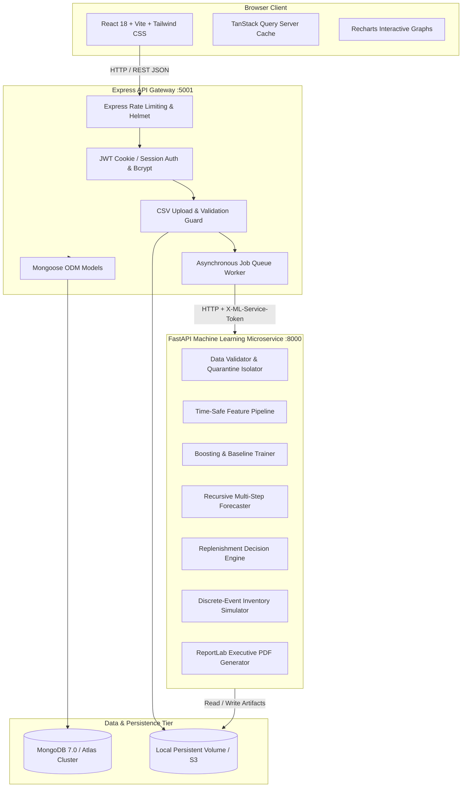

# QuickStock AI: System Architecture

Academic Inventory Decision-Support Prototype for Quick-Commerce Dark Stores.

---

## 1. High-Level Architecture Diagram

---

## 2. Multi-Tier Responsibilities

### Tier 1: Frontend Client (`apps/web`)
- **Framework**: React 18 with TypeScript and Vite.
- **State Management**: TanStack React Query for declarative caching, polling, and background job synchronization.
- **Design System**: Tailored dark-mode accents, glassmorphic panels, responsive sidebar, and accessible form labels.
- **Visualization**: Recharts for demand forecast curves with 80% prediction intervals, feature importance bars, and policy comparison charts.

### Tier 2: Express Node.js Gateway (`apps/api`)
- **Port**: `5001`
- **Security**: Helmet HTTP headers, CORS origin allowlisting, HTTP-only cookie authentication, bcrypt password hashing.
- **CSV Ingestion**: Multer file stream guard with extension inspection, 50MB size limit, and formula-injection escaping (CWE-1236).
- **Job Orchestration**: In-memory and MongoDB-backed job queue limiting concurrency to prevent laptop starvation. Exposes `/api/jobs/:id` for polling.
- **Service Isolation**: The private Python ML microservice is never exposed directly to public internet browsers; all requests route through the Express gateway using an internal secret token (`X-ML-Service-Token`).

### Tier 3: Python ML Microservice (`services/ml`)
- **Port**: `8000`
- **Framework**: FastAPI and Pydantic with type-checked schemas.
- **Core ML**: Scikit-Learn, LightGBM, and XGBoost regressors with bounded laptop-friendly hyperparameters.
- **Time-Safe Feature Pipeline**: Historical target lags and rolling statistics strictly shifted by 1 day to eliminate future peeking.
- **Reporting**: ReportLab 5.1 dynamically compiles executive publication-grade PDF documents.

### Tier 4: Database & Volume Storage
- **Database**: MongoDB 7.0 (local development profile with complete Atlas URI drop-in compatibility).
- **Collections**: `users`, `datasets`, `storeproducts`, `jobs`, `modelruns`, `forecastruns`, `purchaseplans`, `simulationruns`, `auditlogs`.
- **Filesystem**: Clean separation between raw uploads (`data/raw/`), validated datasets (`data/processed/`), synthetic benchmarks (`data/demo/`), serialized models (`artifacts/models/`), and PDF summaries (`artifacts/reports/`).
